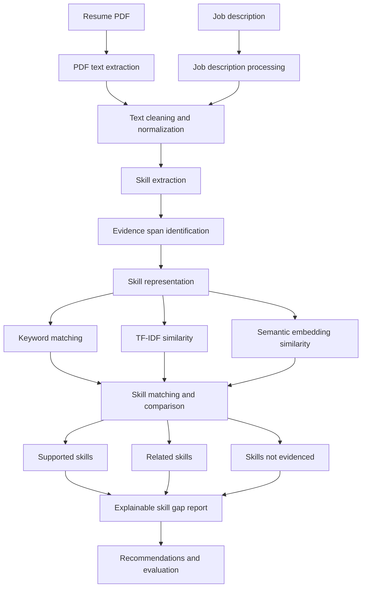

<div align="center">

# Resume Skill Gap Analyzer

### Explainable resume–job alignment using natural language processing

**Python · Research-oriented AI · Reproducible experiments**

`IN PROGRESS` · Initial public project scaffold

</div>

---

## Overview

An NLP application investigating how skill extraction and semantic matching can support transparent comparisons between a resume and a job description.

This repository is being developed as part of a portfolio exploring **reliable, explainable, and evidence-aware AI systems**. The current README describes the intended scope and methodology. Features are marked complete only after they have been implemented and tested.

## Problem statement

Simple keyword overlap can miss related terminology, while unconstrained semantic similarity can overstate a candidate's proficiency. A useful system should show the text supporting each match and avoid turning related experience into an unsupported skill claim.

## Research question

> How can a system identify meaningful skill alignment while distinguishing explicitly evidenced skills, related experience, and skills that are not evidenced in the supplied resume?

## Objectives

- [ ] Resume and job-description text extraction
- [ ] Structured skill identification with supporting text spans
- [ ] Keyword matching baseline
- [ ] TF-IDF and cosine-similarity baseline
- [ ] Sentence Transformer semantic similarity
- [ ] Evidence-based categories: supported, related, and not evidenced
- [ ] Role-specific skill-gap summary and learning suggestions

## Proposed methodology

The project will be developed through explicit baselines, documented implementation choices, and evaluation on a defined dataset or test collection. The exact experimental configuration and results will be added after implementation and validation.

## System architecture

The following diagram represents the **planned** system flow, not a claim that every component is already implemented.



## Evaluation strategy

- Build a manually reviewed set of resume/job-description pairs
- Evaluate skill extraction with precision, recall, and F1
- Compare keyword, TF-IDF, and embedding-based matching
- Measure false-positive skill claims and reviewer agreement
- Inspect performance across varied resume layouts and wording

Evaluation results will be reported with dataset provenance, split strategy, relevant metrics, and representative failure cases. No performance figures are claimed in this initial scaffold.

## Technology stack

Python, Streamlit, spaCy, scikit-learn, Sentence Transformers, pypdf, pandas

## Repository structure

```text
resume-skill-gap-analyzer/
├── app.py                  # Streamlit entry point
├── src/
│   └── resume_analyzer/
│       └── __init__.py
├── data/                   # Local datasets; large/private data excluded from Git
├── reports/                # Experiment protocols and evaluation reports
├── assets/
│   └── screenshots/        # Add genuine application screenshots here
├── tests/                  # Automated tests
├── requirements.txt
├── .env.example
├── .gitignore
├── CONTRIBUTING.md
├── LICENSE
└── README.md
```

## Getting started

### Prerequisites

- Python 3.10 or newer (verify package-specific compatibility during setup)
- Git
- A virtual environment

### Clone

```bash
git clone https://github.com/itirksnasingh/resume-skill-gap-analyzer.git
cd resume-skill-gap-analyzer
```

### Create a virtual environment

**Windows PowerShell**
```powershell
python -m venv .venv
.venv\Scripts\Activate.ps1
```

**macOS / Linux**
```bash
python -m venv .venv
source .venv/bin/activate
```

### Install dependencies and run

```bash
python -m pip install --upgrade pip
pip install -r requirements.txt
streamlit run app.py
```

The current app is an informational scaffold. Core project workflows will be added as development progresses.

## Development roadmap

- [ ] Repository scaffold and project documentation
- [ ] Resume and job-description parsing
- [ ] Skill taxonomy and evidence-span extraction
- [ ] Keyword and TF-IDF baselines
- [ ] Embedding-based semantic comparison
- [ ] Evidence-backed gap explanations
- [ ] Manual evaluation set and error analysis
- [ ] Deployment and demo documentation

## Limitations and responsible use

- A semantic match does not prove practical proficiency.
- Resume content may be incomplete, ambiguous, or self-reported.
- Skill taxonomies and job descriptions vary across roles and industries.
- Learning suggestions are guidance, not objective predictions of employability.

## Current status

| Area | Status |
|---|---|
| Project scope and research question | Defined |
| Repository scaffold and documentation | Prepared |
| Core implementation | In progress |
| Evaluation and results | Pending |
| Deployment | Pending |

## Reproducibility and data policy

- Record dataset name, source, version, and license.
- Do not commit private, sensitive, or unlicensed data.
- Keep credentials in local environment variables or hosting secrets.
- Record model versions, random seeds, preprocessing, and evaluation configuration.
- Distinguish measured results from hypotheses and planned work.

## Author

**Sanskriti Singh**  
B.Tech Computer Science (AI/ML)  
Bharati Vidyapeeth (Deemed to be University)

## License

This project is released under the MIT License. Dataset, pretrained-model, and third-party component licenses remain subject to their respective terms.
